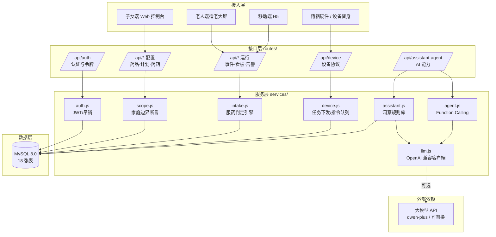

# 安心格 AnCareBox · 智能药箱家庭用药协同系统

> AI Web 应用竞赛参赛作品 · 把「提醒吃药」升级为「防止吃错」

本文档按四部分组织：**项目介绍 → 技术架构 → 安装运行指南 → 团队信息**。

---

## 一、项目介绍

### 1.1 一句话说明

子女在 Web 端远程配置药品与服药时间，药箱按时间窗**只解锁该吃的那一格**，
服药状态自动回传；漏服、重复取药、药物相互作用由 Agent 主动发现并推送。

### 1.2 要解决的问题

市面上的「吃药提醒」产品（手机闹钟、定时药盒）只解决了「提醒」这一层，
真实的居家用药风险是三层叠加的：

| 层次 | 具体表现 | 现有方案的缺口 |
|---|---|---|
| 第一层：忘记 | 到点没吃、吃了没记 | 闹钟会响，但**不知道到底吃没吃** |
| 第二层：吃错 | 拿错格子、重复吃、两种药相冲 | 药盒不设锁，**谁都能打开任意一格** |
| 第三层：无人知晓 | 子女异地，出事几天后才发现 | 没有数据回传，**照护者处于信息盲区** |

本项目的判断是：**只做第一层没有意义**。所以三件事一起做——物理上锁住不该打开的格子，
数据上记录每一次取药，异常上主动推送给子女。

### 1.3 三类使用者

| 角色 | 主要诉求 | 对应界面 |
|---|---|---|
| 老人 | 看得清、操作少、别被打扰 | 老人端大屏（大字号 / 单任务 / 吃完即静音） |
| 子女 | 随时知道今天吃没吃、有没有异常 | 子女端控制台 + 移动端 H5 |
| 药箱硬件 | 知道几点开哪一格、播什么话 | `/api/device/*` 通信协议（18 个接口） |

### 1.4 交付规模

| 指标 | 数值 | 说明 |
|---|---|---|
| 代码行数 | 21,147 行 | 含后端、前端、SQL、脚本，不含依赖 |
| HTTP 接口 | 76 个 | 认证 11 / 配置 31 / 运行 11 / 设备 18 / AI 5 |
| 数据表 | 18 张 / 198 字段 | 业务表 14 张 + 设备对接 4 张 |
| 自动化断言 | 179 项 | 8 个自检脚本，全部可复跑 |
| 演示视频 | 5 分 37 秒 / 1080p | 见交付材料 |

---

## 二、技术架构

### 2.1 总体分层



**分层原则**：接口层只做参数校验与响应组装，不含业务判断；
服务层不感知 HTTP，可被脚本直接调用；数据层统一走连接池，
所有按 id 取资源的入口先过 `scope.js` 的家庭归属断言。

### 2.2 技术选型与放弃理由

| 选型 | 采用 | 放弃的方案 | 为什么 |
|---|---|---|---|
| 后端框架 | Express 4 | NestJS / Spring Boot | 项目只有 76 个接口，NestJS 的依赖注入与模块装饰器带来的抽象成本高于收益；Spring Boot 需另起 JVM 与构建链，与前端不同语言，评审阅读成本翻倍 |
| 前端形态 | 原生 HTML/CSS/JS | React / Vue + 构建工具 | 三套界面共 5 个页面，无需状态管理与路由；无构建步骤意味着**评审下载即可运行**，不必先 `npm run build` |
| 数据库 | MySQL 8.0 | MongoDB | 用药计划、服药事件、告警之间存在明确的多表关联与统计需求（依从率按周聚合），关系模型更贴合；JSON 字段仅在设备原始报文处使用 |
| AI 接入 | OpenAI 兼容协议直连 | LangChain / 官方 SDK | 多一层框架就多一层版本耦合；OpenAI 兼容协议是事实标准，换模型只改 `LLM_BASE_URL` 与模型名两行 |
| AI 工具调用 | Function Calling | 让模型直接生成 SQL | 模型写 SQL 无法限制作用域，一旦表名猜错就查不到数据、猜对则可能越权；工具调用把可执行动作收敛为白名单函数，参数由 schema 约束 |
| 设备通信 | HTTP 轮询 | WebSocket 长连接 | 药箱是电池供电设备，长连接保持成本高且断线重连复杂；60 秒心跳轮询的功耗与实时性对本场景足够 |

### 2.3 目录结构

```
smart-medbox/
├── .env.example          配置模板（复制为 .env 后填写，无真实凭据）
├── .gitignore            排除 .env / node_modules / 用户录音 / 数据库导出
├── README.md             本文件
├── package.json
├── 一键启动Web应用.bat    Windows 一键启动（依赖检查 → 建库 → 启动）
├── 打开老人端.bat         老人端快捷入口
├── sql/
│   ├── 01_schema.sql     建表语句（18 张表，含字段注释）
│   ├── 02_seed.sql       演示数据
│   ├── 03_auth.sql       鉴权相关表变更 + 第二个演示家庭
│   ├── 04_demo_data.sql  李家数据补全（药品/计划/录音/提醒策略）
│   ├── 05_device_session.sql  设备会话持久化（令牌不再只依赖浏览器存储）
│   ├── 06~12_*.sql       共享药箱、药品成分、配伍禁忌、效期、条码等增量脚本
│   └── 13_device_api.sql 设备对接：指令队列 / 遥测 / 固件 / 日志 四张表
├── server/
│   ├── app.js            服务入口（helmet / 限流 / cookie 解析）
│   ├── db.js             MySQL 连接池
│   ├── services/
│   │   ├── auth.js       ★ JWT 签发、验证、密码哈希、鉴权中间件
│   │   ├── scope.js      ★ 数据归属校验（防横向越权）
│   │   ├── http.js       统一错误处理（区分 401 / 403 / 404）
│   │   ├── intake.js     ★ 服药判定核心逻辑
│   │   ├── device.js     ★ 设备任务单、指令队列、配置指纹
│   │   ├── assistant.js  ★ 洞察规则库 + 药物相互作用研判
│   │   ├── agent.js      ★ Function Calling 代理执行（16 个工具）
│   │   ├── llm.js        OpenAI 兼容客户端（超时与预算控制）
│   │   └── vision.js     拍照识药（视觉模型）
│   └── routes/
│       ├── auth.js       登录 / 刷新 / 登出 / 改密 / 注册 / 绑定码
│       ├── config.js     配置类 CRUD（老人/药品/计划/隔间/录音）
│       ├── runtime.js    运行类（事件上报/告警/看板/SOS）
│       ├── device.js     /api/device/* 设备协议（18 个接口）
│       ├── assistant.js  洞察与问答
│       └── agent.js      Agent 对话与工具调用
├── scripts/
│   ├── init-db.js        一键全量重置：建库建表 + 账号 + 两家完整演示数据
│   ├── seed-auth.js      生成演示账号与绑定码（bcrypt 哈希）
│   ├── seed-demo.js      两家近 14 天服药记录生成器（固定随机种子，可复现）
│   ├── migrate-device.js 设备对接表增量迁移（幂等）
│   ├── device-agent.js   ★ 设备替身：完整走一遍真机生命周期（67 项断言）
│   ├── device-sim.js     早期设备模拟器（已带令牌）
│   ├── clean-agent-data.js  清理替身测试数据（只删 agent- 前缀）
│   ├── check-db.js       数据库连通性与表结构检查
│   ├── health-probe.js   健康检查（给 bat 判断服务是否活着）
│   ├── print-lan-ip.js   打印局域网地址，供手机访问
│   ├── probe-firstscreen.js     首屏全链路探针（定位到底哪个接口报错）
│   ├── probe-device-session.js  ★ 令牌持久化与「清了浏览器能自愈」验证（22 项）
│   ├── probe-elder-take.js      老人端打卡链路验证
│   ├── probe-assistant.js       AI 问答链路验证
│   └── test-auth.js      ★ 鉴权自检（37 项）
├── _audit/               交付前自检脚本与说明
├── docs/
│   ├── DEVICE_PROTOCOL.md  设备通信协议（20 节，硬件可照此实现）
│   ├── ASSISTANT_API.md    AI 助手接口契约
│   └── LLM_SETUP.md        大模型接入配置指引
└── public/
    ├── login.html        登录页
    ├── index.html        子女端控制台
    ├── elder.html        老人端大屏（适老化）
    ├── landing.html      产品落地页
    ├── js/               api.js / child.js / elder.js / config.js
    ├── css/              style.css / login.css
    ├── audio/            子女录音（运行期生成，不入库）
    └── m/                移动端 H5（index / elder / landing / login）
```

### 2.4 数据模型

数据库：`smart_medbox`，共 **18 张表**——14 张业务表（下表）+ 4 张设备对接表
（`device_command` / `device_status` / `device_firmware` / `device_log`，见 2.8）。

| 层级  | 表名                                                                       | 作用               |
| --- | ------------------------------------------------------------------------ | ---------------- |
| 主体层 | `family` `user` `elder`                                                  | 谁在用：家庭、子女账号、老人档案 |
| 配置层 | `medbox` `compartment` `medicine` `schedule` `schedule_item` `recording` | 子女设定的规则          |
| 关联层 | `medbox_elder`                                                           | 一箱多老人共用（一台药箱绑定多位老人） |
| 运行层 | `intake_event` `alert`                                                   | 药箱每天产生的流水与告警     |
| 安全层 | `device_session` `audit_log`                                             | 登录会话与操作留痕        |

> `device_session` 与 `medbox_elder` 为后期新增的表：前者把设备令牌持久化到服务端，
> 目的是让老人端在浏览器数据被清理后仍能自动恢复（详见 2.6 第 5 条）；
> 后者支撑「一箱多老人」共用，计划 / 提醒 / 告警按老人隔离。

**表之间的关系（→ 表示"多对一"）**

```
family ──┬── user          （一个家庭多个子女）
         ├── elder         （一个家庭多位老人）
         ├── medbox        （一个家庭多个药箱）
         └── medicine      （药品库按家庭隔离）

elder  ──→ medbox          （药箱绑定老人）
medbox ──→ compartment     （一个药箱 7 个隔间）

schedule ──→ elder + compartment   （一个服药时间点绑定一个隔间）
schedule_item ──→ schedule + medicine （这一格放哪几种药、各几片）

recording ──→ elder (+ schedule)   （子女方言录音，优先于机器语音）

intake_event ──→ elder / medbox / compartment / schedule
alert ──→ elder (+ intake_event)

medbox ──→ device_session   （一个药箱可以绑过多台设备，每台一条记录）
```

**核心设计：一格 = 一次量**

`schedule`（服药时间点）绑定 `compartment`（物理隔间），
`schedule_item` 说明这个隔间里放了哪几种药、各几片。

于是「到点只解锁该次该吃的那一格」在数据库层面有了明确依据——
这也是本作品区别于市面「只提醒不防错」产品的关键。

**几个关键字段的用意**

- `elder.volume_level / speech_rate / hearing_level`：老人听力决定音量与语速档位（对应方案书功能 8）
- `elder.timeout_minutes`：超过即判定漏服（默认 30 分钟）
- `elder.duplicate_window_minutes`：此分钟内再次开箱 = 疑似重复服药（默认 2 分钟）
- `schedule.window_before_min / window_after_min`：时间窗，窗口外开箱判定为 `abnormal`
- `intake_event.source`：区分 `device`（真实设备）与 `simulator`（比赛演示模拟器），数据可信度可追溯
- `schedule_item` 外键 `ON DELETE RESTRICT`：药品被计划引用时不允许删除，防止计划静默失效

建表语句见 **`sql/01_schema.sql`**，演示数据见 **`sql/02_seed.sql`**，
鉴权相关变更见 **`sql/03_auth.sql`**，效期告警枚举增量迁移见 **`sql/11_expiry_alert.sql`**，
药品条码字段增量迁移见 **`sql/12_medicine_barcode.sql`**。

新增的三处：

- `user.token_version` —— 令牌版本号，登出/改密时 +1 使旧令牌失效
- `medbox.bind_code` + `bind_code_expires_at` + `token_version` —— 药箱绑定码与设备令牌版本
- `audit_log` 表 —— 配置变更留痕，改错剂量时能追溯「谁、何时、把什么改成了什么」

### 2.5 关键数据流

**服药事件从上报到告警的完整链路**：

```
药箱开箱
  → POST /api/device/events（携带 client_event_id 用于幂等）
  → intake.js 判定：落在窗口内？on_time / early / late / missed / duplicate
  → 写入 intake_event（只追加，不修改）
  → 命中异常规则 → 写 alert → 子女端看板与推送
  → assistant.js 定期扫描 → 生成健康洞察 → 可选由大模型补充研判
```

**AI 请求的降级路径**：

```
前端请求
  → 规则引擎先算（毫秒级，确定性强）
  → 有 LLM_API_KEY 且未超预算 → 调用模型增强（2500ms 预算）
  → 超时 / 无 Key / 调用失败 → 直接返回规则结论，engine='rule'
```

降级不是异常分支，而是**默认设计**：接口契约在两种模式下完全一致，
前端无需感知当前用的是哪一条路径。

### 2.6 身份认证与权限边界

**为什么必须有**

改造之前，36 个接口一行鉴权都没有。后果不只是"能看到别人数据"这么简单：

```bash
curl -X DELETE http://localhost:3000/api/medicines/1        # 删掉别人家的药品
curl -X POST http://localhost:3000/api/sos -d '{"elder_id":1}'  # 伪造求救，吓唬家属
curl -X POST http://localhost:3000/api/events -d '...'      # 伪造「已服药」记录
```

**最后一条最致命**：服药流水一旦可伪造，漏服告警和依从性数据就全废了——
这个产品的价值恰恰建立在这些数据可信之上。

**三类令牌**

| 令牌           | 发给谁      | 有效期   | 存放位置                                    | 能做什么                                 |
| ------------ | -------- | ----- | --------------------------------------- | ------------------------------------ |
| user 访问令牌    | 子女       | 2 小时  | localStorage                            | 按角色 `owner` / `member` / `viewer` 分级 |
| refresh 刷新令牌 | 子女       | 30 天  | httpOnly Cookie（JS 读不到）                 | 只用来换新的访问令牌                           |
| device 设备令牌  | 药箱 / 老人端 | 180 天 | localStorage + **服务端 device_session 表** | 只能操作绑定的那一位老人                         |
| device 长期凭证  | 药箱 / 老人端 | 180 天 | httpOnly Cookie                         | localStorage 被清时，凭它换回令牌              |

> 最后一行是后期补上的。原因见下方「为什么把令牌搬到服务端」。

**五个关键设计**

**1. 令牌版本号 —— 让 JWT 可以"收回"**

JWT 天生有个短板：签发后服务端不留状态，想作废作废不了。
解法是令牌里带一个版本号 `tv`，库里 `user.token_version` 存当前版本。
登出、改密、解绑时把版本号 +1，旧令牌的 `tv` 就对不上，等效于立即失效。

**2. 家庭隔离 —— 挡住横向越权**

这是最容易被漏掉的一环。光做登录没用：A 登录后把请求里的 id 换成 B 的，
照样能看到 B 的数据。所以本项目定了一条硬规矩：

```sql
-- 错误：只按 id 查，谁都能看
SELECT * FROM schedule WHERE id = ?

-- 正确：强制带家庭归属，family_id 从令牌取，不信前端传的值
SELECT s.* FROM schedule s JOIN elder e ON e.id = s.elder_id
 WHERE s.id = ? AND e.family_id = ?
```

改造前 `config.js` 里多处写着 `b.family_id || 1`（家庭归属由前端决定），已全部修掉。

**3. 老人端不需要密码**

目标用户记不住密码，也不该有密码。流程是：

```
子女在控制台点「生成绑定码」 → 得到 6 位数字（5 分钟有效）
                                    ↓
药箱/老人端输入这 6 位 → 换回一张 180 天的设备令牌
                                    ↓
老人全程零操作；子女可随时「解绑」，令牌立即失效
```

**4. 设备上报身份由令牌决定**

设备上报事件时，`device_code` 强制取令牌里的值，body 里传什么都覆盖掉——防止冒名上报。

**5. 为什么把令牌搬到服务端（`device_session` 表）**

初版设备令牌只存在浏览器的 localStorage，服务端一行记录都没有。缺点很具体：

> 老人一旦清了浏览器数据，令牌就没了，页面直接失联。
> 要恢复，必须让子女重新生成绑定码再念给老人听——而老人往往独自在家，做不到这一步。

对一个「给独居老人用的用药提醒产品」来说，这是可用性事故，不是小毛病。改造办法是把
凭证拆成两半，分开放：

| 存哪儿                    | 是什么  | 有什么用        | 被偷的风险          |
| ---------------------- | ---- | ----------- | -------------- |
| localStorage           | 设备令牌 | 每次请求证明身份    | 丢了能再换          |
| httpOnly Cookie        | 长期凭证 | 令牌丢了能静默补回来  | JS 读不到，XSS 偷不走 |
| MySQL `device_session` | 会话记录 | 服务端可吊销、可查在线 | 库被攻破才泄露        |

于是清了 localStorage 之后：页面发现自己没令牌 → 拿 Cookie 悄悄换一张 → 老人完全无感知。
新增加的一行 failover 换来整个使用体验的稳定，这笔账很划算。

顺带得到两个能力：`last_seen_at` 让子女能看到「药箱最后一次联网时间」（离线告警的基础）、
`revoked_at` 让解绑精确命中某一台设备，而不是像 `token_version` 那样把整个药箱一起踢掉。

**必须如实说明的边界**：如果用户执行的是「清除浏览数据（含 Cookie）」的完整清理，
Cookie 一样会被删，这时仍需重新绑定一次。**这是浏览器沙箱的既定设计，
任何纯网页方案都做不到百分之百免疫**，真实产品应当做成 App 或在硬件上固化凭证。
本项目不假装能解决这个问题，只把可解决的那部分做到位。

验证方式见 3.6。

### 2.7 服药判定引擎

在 `server/services/intake.js`，药箱每上报一条事件就走一遍：

| 情况                        | 判定             |
| ------------------------- | -------------- |
| 在 `[计划时间, 计划时间+延后窗口]` 内取药 | `on_time` 按时   |
| 在 `[计划时间-提前窗口, 计划时间)` 内取药 | `early` 提前     |
| 超过延后窗口                    | `late` 延迟      |
| 完全在窗口外开箱                  | `abnormal` 异常  |
| 同一计划 2 分钟内再次取药            | `duplicate` 重复 |
| 超时未取药                     | `missed` 漏服    |

`missed / duplicate / abnormal` 会自动生成一条 `alert` 推送给子女。

### 2.8 设备对接与通信协议

#### 2.8.1 实物药箱：接口已全部留好

实物还没接电脑也没关系。设备侧接口统一在 `/api/device/*` 下，按真机需求一次留全，
接到实物后不需要再改后端。完整契约见 **[docs/DEVICE_PROTOCOL.md](docs/DEVICE_PROTOCOL.md)**。

一句话概括设备要做什么：

```
上电 → handshake（认身份/对时/拿全量配置）
待机 → heartbeat 每 60 秒（证明在线/取指令/看配置变没变）
到点 → tasks 拿当天任务单，本地执行（断网也能跑一整天）
动作 → events 单条上报；断网期间的攒起来，恢复后 events/batch 批量补传（幂等）
异常 → fault 报硬件故障；老人按键 → sos
```

数据库里设备要用的字段和表已经补齐（可重复执行，幂等）：

```bash
npm run migrate:device
```

#### 2.8.2 设备替身：没有实物时用它验证接口

`npm run device` 会完整走一遍真机的生命周期，每一步都有断言，跑不过是它自己报错：

```bash
npm run device              # 完整流程，67 项断言
npm run device -- --loop    # 常驻心跳，模拟待机中的真机
npm run device -- --sos     # 额外触发一次 SOS
npm run device -- --verbose # 打印每个接口的完整报文
```

它会真的写服药事件（故意的，只有真写才验证得了判定链路）。演示前清掉自己的测试数据：

```bash
npm run clean:agent            # 清事件与相关告警
npm run clean:agent -- --sos   # 连测试触发的 SOS 一起清
```

只删 `client_event_id` 以 `agent-` 开头的行，不碰任何真实数据。

#### 2.8.3 早期的事件流模拟器（只发事件，不跑完整生命周期）

比赛演示时用它快速制造事件流：

```bash
npm run sim              # 每 20 秒产生一条事件
npm run sim -- --once    # 只产生一条按时取药
npm run sim -- --miss    # 只产生一条漏服（会触发告警）
npm run sim -- --dup     # 只产生一条重复取药
```

账号不对时用环境变量指定：

```bash
SIM_USERNAME=wang_owner SIM_PASSWORD=medbox2026 npm run sim
```

### 2.9 AI 技术架构

AI 能力不是「接一个大模型就完事」，而是**规则打底、模型增强、失败可退**的三层结构。

| 层 | 实现 | 职责 | 无 Key 时 |
|---|---|---|---|
| 洞察层 | `assistant.js` 规则库 | 漏服、重复服药、低库存、依从性下滑、效期、设备离线等七类风险，可复现、可溯源 | 正常输出 |
| 研判层 | 三阶段冲突检测 | 规则命中原生候选 → 模型逐条复核（结合慢病、过敏史、年龄，区分「明确危险 / 需监测 / 规则误报」）→ 模型补扫规则库未覆盖的两两组合；任一步失败即退回上一阶段结论 | 只用规则阶段 |
| 执行层 | `agent.js` Function Calling | 16 个白名单工具读写业务数据；`WRITE_TOOLS` 对 `viewer` 角色直接拦截；删除类操作先返回待确认，不代用户决定 | 退化为只读问答 |

三个工程约束：

- **预算共享**：一次请求的总预算 2500ms，规则与模型共用同一个 deadline，不会因为「先规则后模型」把响应拖成两倍；
- **契约一致**：返回体都有 `engine` 字段（`rule` / `llm`），前端不感知当前走哪条路；
- **提示词写死边界**：不诊断、不开方、附来源、无关话题礼貌拉回，边界写在系统提示词里而非靠事后过滤。

接口契约见 **`docs/ASSISTANT_API.md`**，接入步骤见 **`docs/LLM_SETUP.md`**。

### 2.10 接口清单

除 `/api/health` 和 `/api/auth/*` 外，**所有接口都必须带令牌**：
`Authorization: Bearer <token>`

**认证接口（无需登录）**

| 方法   | 路径                          | 说明                           |
| ---- | --------------------------- | ---------------------------- |
| POST | `/api/auth/login`           | 登录，返回访问令牌 + 写刷新令牌 Cookie     |
| POST | `/api/auth/refresh`         | 刷新令牌换访问令牌（静默续期）              |
| POST | `/api/auth/logout`          | 登出，令牌版本 +1                   |
| GET  | `/api/auth/me`              | 当前身份                         |
| POST | `/api/auth/change-password` | 改密，其他设备会话全部下线                |
| POST | `/api/auth/register`        | 注册（自动创建新家庭 + owner）          |
| POST | `/api/auth/bind-code`       | 子女端生成药箱绑定码（5 分钟）             |
| POST | `/api/auth/device-bind`     | 药箱用绑定码换设备令牌，并种下长期凭证 Cookie   |
| POST | `/api/auth/device-refresh`  | 凭 Cookie 换回令牌（浏览器数据被清后的恢复通道） |
| POST | `/api/auth/device-unbind`   | 解绑药箱（owner），令牌与凭证一起失效        |

**业务接口（需登录，且自动按家庭隔离）**

| 方法                  | 路径                          | 说明              | 权限        |
| ------------------- | --------------------------- | --------------- | --------- |
| GET                 | `/api/health`               | 服务与数据库状态        | 公开        |
| GET/POST/PUT/DELETE | `/api/elders`               | 老人档案 + 提醒策略     | 删除仅 owner |
| GET/POST/PUT/DELETE | `/api/medicines`            | 药品              | 删除仅 owner |
| GET/POST/PUT/DELETE | `/api/schedules`            | 服药计划（含明细）       | 删除仅 owner |
| GET/POST            | `/api/medbox`               | 药箱              | member+   |
| GET/PUT             | `/api/compartments/:id`     | 隔间锁定状态          | member+   |
| GET/POST/PUT/DELETE | `/api/recordings`           | 方言录音            | 删除仅 owner |
| POST                | `/api/recordings/upload`    | 录音上传（base64）    | member+   |
| POST                | `/api/events`               | **设备上报事件**（核心）  | 设备身份由令牌决定 |
| GET                 | `/api/events`               | 服药记录查询          | 按家庭隔离     |
| GET                 | `/api/events/today`         | 老人端今日概览         | 按家庭隔离     |
| GET/PUT             | `/api/alerts`               | 告警列表与处理         | 按家庭隔离     |
| GET                 | `/api/auth/device-sessions` | 药箱绑过哪些设备、最后在线时间 | member+   |
| POST                | `/api/sos`                  | 老人求助            | 老人身份由令牌决定 |
| GET                 | `/api/dashboard/:elderId`   | 依从性看板           | 按家庭隔离     |

**设备侧接口（只认设备令牌，完整契约见 `docs/DEVICE_PROTOCOL.md`）**

| 方法 | 路径 | 说明 |
| --- | --- | --- |
| POST | `/api/device/handshake` | 上电报到：身份、能力集、对时、全量配置、今日任务、积压指令 |
| POST | `/api/device/heartbeat` | 心跳：刷新在线、回收遥测、取指令、给下一顿任务 |
| GET | `/api/device/config` | 全量配置（含配置指纹，用于判断要不要重拉） |
| GET | `/api/device/tasks` | 当天任务单（时间窗/格号/提醒时刻表/播报文案/超时） |
| POST | `/api/device/events` | 单条事件上报（开箱/取药/关箱/超时/被拦） |
| POST | `/api/device/events/batch` | 断网补传批量上报，`client_event_id` 幂等 |
| GET | `/api/device/commands` | 取待执行指令（取走即置 sent，不重复执行） |
| POST | `/api/device/commands/:id/ack` | 指令回执（重复回执幂等） |
| POST | `/api/device/slots` | 格位状态：余量/是否空/传感器好坏 |
| POST | `/api/device/status` | 设备自检：电量/信号/温度/门磁/固件版本 |
| POST | `/api/device/fault` | 硬件故障上报 → fault 告警 |
| POST | `/api/device/sos` | 老人「我不舒服」，同时排现场安抚播报 |
| GET | `/api/device/recordings` | 方言录音清单（绝对 URL） |
| GET | `/api/device/firmware` | OTA 检查（接口已留好，插一行数据即可发版） |
| POST | `/api/device/logs` | 上传诊断日志（真机排障用，保留 7 天） |
| GET | `/api/device/logs` | 回读诊断日志 |
| GET | `/api/device/time` | 单独校时 |

**子女端远程控制（给上面那组接口喂指令）**

| 方法 | 路径 | 说明 |
| --- | --- | --- |
| POST | `/api/medbox/:id/commands` | 下发指令：ring / led / unlock / lock / speak / sync / reboot / locate |
| GET | `/api/medbox/:id/commands` | 指令历史与执行状态 |

### 2.11 老人端「安静」设计

用药提醒类产品最容易犯的错，是**把提醒做成骚扰**。本项目按「顿」来管理播报：

| 时机        | 行为                           |
| --------- | ---------------------------- |
| 打开老人端     | **不播报**，静默入场，屏幕上直接显示该吃什么     |
| 到点了（新的一顿） | 播报**一次**，有子女录音则播录音           |
| 按下「我吃好了」  | 立刻掐断语音/录音，收起吃药按钮，换成「已经吃好了」提示 |
| 吃完到下一顿之间  | **完全安静**，`我不舒服` 按钮始终保留，可随时求助 |
| 下一顿时间到    | 自动重新开始提醒                     |

实现要点：`load()` 每 60 秒自动刷新一次，如果每次都 `announce()`，
老人就会被反复催促。所以引入 `remindKey()`（按 `schedule.id` 标识一顿），
配合 `announcedKey` / `finishedKey` 两个状态，做到「同一顿只提醒一次，吃完即静音」。

服务端 `/api/events/today` 返回的是**离当前时刻最近**的那条计划（与吃过与否无关），
所以吃完之后仍返回同一顿，`finishedKey` 判定成立、静音得以维持；
等时间走到下一顿，`schedule.id` 自然变化，提醒自动恢复 —— 不需要额外的定时器。

> 「我不舒服」是求救通道，任何状态下都不会被收起或禁用。

### 2.12 部署形态

单进程 Node.js 服务，监听 3000 端口，对外提供静态页面与 REST 接口，
数据持久化在本地 MySQL。无容器、无反向代理依赖，`npm start` 即可运行。
手机访问通过局域网 IP（`npm run lan-ip` 可打印地址）。

### 2.13 已知限制与安全边界

1. **刷新令牌未做轮换**：当前刷新令牌 30 天内可重复使用。生产环境应在每次刷新时签发新的、并作废旧令牌（Refresh Token Rotation）。
2. **长期凭证同样不做轮换**：设备的 httpOnly 凭证在 180 天内可反复换令牌。这是有意的取舍——设备不像人，没有密码，可用凭证太多反而增加被盗面；权衡后选择「长期有效 + 可被服务端吊销」（见 `device_session.revoked_at`）。
3. **录音文件可被直接访问**：`public/audio/` 下的文件未做权限校验，知道 URL 就能下载。生产环境应改为「签名临时 URL」。这是本次比赛范围外的已知缺口，如实登记于此。
4. **未做登录失败锁定**：目前只有 IP 维度限流（15 分钟 20 次），没有按账号维度锁定。
5. **硬件为场景载体**：药箱电控锁依赖实体设备，本项目用「设备模拟器 + 通信协议」解耦，软件系统本身不绑定硬件。
6. **清理浏览数据后能否恢复，取决于清理力度**：只清 localStorage 可自动恢复；Cookie 一起被清则必须重新绑定。这是浏览器沙箱的设计，纯 Web 无法免疫，真实产品应做 App 或硬件固化凭证。
7. **不做诊断**：所有药品提示均为科普性提示，不构成医疗建议——这是刻意守住的合规边界。

以上 7 条是**刻意留下的边界**，不是遗漏：比赛原型要跑通的是「识别风险 → 提醒 → 闭环」，
而真实产品还要补设备侧 HMAC 签名认证、文件签名临时 URL、按账号维度的锁定与审计日志留存，
这些都需要额外的服务端组件与合规流程，不在本次实现范围内。

---

## 三、安装运行指南

### 3.1 前置条件

| 依赖 | 版本 | 说明 |
|---|---|---|
| Node.js | 18 或以上 | 推荐 20 LTS；`node -v` 可查看 |
| MySQL | 8.0 | 需已启动服务；Windows 下服务名为 `MySQL80` |
| 大模型 API Key | 可选 | **不填也能完整运行**，AI 问答会自动降级为内置规则引擎 |

### 3.2 环境变量配置（第一次运行必做）

仓库中**不含** `.env`（内含数据库密码与密钥，按惯例不入版本库）。请复制模板后填写：

```bash
copy .env.example .env        # Windows；Linux / macOS 用 cp .env.example .env
```

然后编辑 `.env`，至少填这三项：

| 变量 | 必填 | 填什么 |
|---|---|---|
| `DB_PASSWORD` | 是 | 部署环境 MySQL 的 root 密码 |
| `DB_NAME` | 是 | 默认 `smart_medbox`，不建库也行，`init-db` 会自动创建 |
| `JWT_SECRET` | 是 | 任意随机长字符串。生成方式：`node -e "console.log(require('crypto').randomBytes(32).toString('hex'))"` |
| `LLM_API_KEY` | 否 | 留空则 AI 功能走规则引擎，所有接口行为不变 |

完整变量说明见 `.env.example` 内注释，或 **`docs/LLM_SETUP.md`**（大模型接入的申请与配置步骤）。

### 3.3 三步启动

```bash
# 1. 安装依赖（只需一次）
npm install

# 2. 一键初始化：建库建表 + 演示账号 + 两家完整演示数据 + 近 14 天服药记录
npm run init-db

# 3. 启动服务
npm start
```

> Windows 用户也可以直接双击 **`一键启动Web应用.bat`**：脚本会依次完成依赖检查、
> 数据库连通性检查、缺依赖时自动安装，并在端口被占用时给出提示。

> `npm run init-db` 是**全量重置**：会清空所有表并重新灌入（每次绑定码也会刷新）。
> 只想给现有库补测试数据、不动账号配置时，单独跑 `npm run seed-demo` 即可。

### 3.4 访问入口与演示账号

- **登录页** → <http://localhost:3000/login.html> （先登录，再进控制台）
- 子女端控制台 → <http://localhost:3000/index.html>
- 老人端大屏 → <http://localhost:3000/elder.html>
- 服务健康检查 → <http://localhost:3000/api/health>（不需要登录）

**演示密码统一为 `medbox2026`**，登录页下方有三个演示账号，点一下即自动填充。
账号对应的手机号是 `13800000001` 一类占位号，不含真实个人信息；真实部署时应修改默认密码。

`npm run init-db` 生成的 14 天数据（固定随机种子，每次重跑结果一致）：
**王秀英按时率约 93%**（近 7 天满分，演示"管理得好"），**李奶奶约 70%**（有漏服、重复开箱、低库存告警，演示"问题发现-处理"闭环）。两家对比着讲，效果最好。

老人端不用密码：首次打开输入 6 位**绑定码**即可。绑定码有两个来源——

1. 下表中的长效演示码（7 天，仅为演示放宽，真实产品应为 5 分钟）；
2. **子女端控制台「隔间管理 → 生成绑定码」现场生成**（5 分钟有效，真实产品的正确姿势）。
   每个药箱同时只有一个有效码，现场生成新码后表中的旧码立即作废。

<!-- DEMO_ACCOUNTS:BEGIN 本节表格由 scripts/seed-auth.js 自动写入，请勿手工编辑 -->
**子女端登录**（<http://localhost:3000/login.html>）

| 账号 | 密码 | 家庭 | 姓名 | 角色 | 说明 |
|---|---|---|---|---|---|
| wangxm | medbox2026 | 王家 | 王小梅 | owner 主配置人 | 可配置王家全部数据 |
| wanggg | medbox2026 | 王家 | 王国栋 | member 可配置 | 可配置王家全部数据 |
| wang_owner | medbox2026 | 王家 | 王大明 | owner 主配置人 | 可配置王家全部数据 |
| wang_member | medbox2026 | 王家 | 王小丽 | member 可配置 | 可配置王家全部数据 |
| li_owner | medbox2026 | 李家 | 李强 | owner 主配置人 | 另一家庭，用于验证越权拦截（看不到王家数据） |

**药箱绑定码**（老人端 <http://localhost:3000/elder.html>，首次打开输入即可，之后自动记住）

| 药箱编号 | 绑定码 | 有效期 |
|---|---|---|
| MB-2026-0001 | 867667 | 7 天（演示放宽，生产应为 5 分钟） |
| MB-2026-0002 | 583362 | 7 天（演示放宽，生产应为 5 分钟） |

**越权自测**：用 `li_owner` 登录后，控制台老人列表只能看到李奶奶、看不到王大爷，即家庭隔离生效。

> 上表的绑定码以**最新一次** `npm run init-db` / `npm run seed-auth` 生成的为准；
> 在子女端「隔间管理 → 生成绑定码」现场生成新码后，表中旧码立即作废。
<!-- DEMO_ACCOUNTS:END -->

### 3.5 数据库初始化与增量迁移

**首次安装**用 `npm run init-db`（见 3.3），一次建好 18 张表并灌入演示数据。

**已有旧库升级**不走全量重置，按需跑增量脚本（全部幂等，可重复执行）：

| 场景 | 命令 | 说明 |
|---|---|---|
| 补齐设备对接 4 张表 | `npm run migrate:device` | `sql/13_device_api.sql` |
| `alert.alert_type` 缺 `expiry` | 见下方单条命令 | 效期告警无法落库时用 |

第二种情况的表现：终端刷 `[assistant] 效期告警落库失败`，前端收不到效期提醒。
只跑增量脚本即可，不必重建库：

```bash
# PowerShell（在项目根目录执行，密码替换为实际值；用户名/库名默认 root / smart_medbox）
Get-Content sql\11_expiry_alert.sql -Raw -Encoding UTF8 | `
  mysql -h 127.0.0.1 -u root -p实际密码 --default-character-set=utf8mb4 smart_medbox
```

cmd 下等价写法：`mysql -u root -p smart_medbox < sql\11_expiry_alert.sql`

验证是否已含 `expiry`：`mysql -u root -p smart_medbox -e "SHOW COLUMNS FROM alert LIKE 'alert_type'\G"`

> 若 MySQL 连不上，先确认 Windows 服务 `MySQL80` 已启动。

### 3.6 自检与测试

全部脚本可重复运行，不需要手工造数据：

| 命令 | 覆盖内容 | 断言数 | 副作用 |
|---|---|---|---|
| `npm test` | 一次跑完全部自检 | 179 项 | 会写测试数据，末尾自动恢复 |
| `npm run test:auth` | 未登录拦截、越权、角色权限、令牌吊销、伪造令牌 | 37 | 会真的解绑 MB-2026-0001，末尾自动恢复 |
| `node scripts/probe-device-session.js` | 绑定种 Cookie、会话落库、清空 localStorage 后静默恢复、解绑后拒绝 | 22 | 会解绑重绑 |
| `npm run device` | 设备替身完整生命周期（含 6 项越权边界） | 67 | 写入 `agent-` 前缀事件，可一键清理 |
| `node scripts/probe-firstscreen.js` | 首屏全链路探针，直接指出哪个接口报错 | — | 只读 |

`test:auth` 与 `probe-device-session.js` 为了验证「解绑后立即失效」会真的操作演示数据，
末尾已加入自动恢复（重跑 `seed-auth` 重签绑定码），看到 `演示环境已恢复` 即表示演示数据已可用。

清理设备替身写入的测试数据：

```bash
npm run clean:agent            # 清事件与相关告警
npm run clean:agent -- --sos   # 连测试触发的 SOS 一起清
```

只删 `client_event_id` 以 `agent-` 开头的行，不碰真实数据。

### 3.7 常见问题排查

**先搞清楚「红字」是什么**

页面上的**红色提示条**不是程序崩溃，它的含义是：**某个接口返回了错误**。
因为它来自 `public/js/api.js` —— 只要任意一个接口返回非 2xx，它就会弹一条红字。

所以排查思路只有一句话：**找出是哪个接口报错了。**

**三步定位**

第 1 步：确认服务还活着。浏览器打开 <http://localhost:3000/api/health>，
看到 `{"ok":true,"server":"up"...}` 说明服务正常；打不开说明服务已经停了 ——
回桌面双击「双击启动Web应用.bat」，并且**黑色窗口不能关**。

第 2 步：跑全链路探针（这一步能直接指出是哪个接口）。

```bash
node scripts/probe-firstscreen.js
```

它会模拟浏览器把首屏链路全打一遍（子女端登录 + 6 个接口 + 老人端绑定），
哪个接口出错，就会标 `[FAIL]` 并把服务端返回的原文打印出来。

第 3 步：确认账号和绑定码是最新的。
绑定码**每次执行 `npm run init-db` 或 `npm run seed-auth` 都会重新签发**，
每个药箱同一时刻只有一个有效码。文档里的旧码用过即废 —— 这是老人端最常见的红字来源。
最新的账号与绑定码永远以 **3.4 节表格**为准。

**常见情况对照表**

| 现象                            | 原因                | 处理                                                |
| ----------------------------- | ----------------- | ------------------------------------------------- |
| 整页打不开、连接被拒绝                   | 服务已停止（黑窗口被关了）     | 重新双击启动 bat                                        |
| 老人端输码后底部红字                    | 绑定码过期作废了          | 用 3.4 节表格里的最新码；或在子女端「隔间管理 → 生成绑定码」现生成 |
| **点「我已吃药」报 `device_code 必填`** | 老人端网页上现在是**子女令牌** | 见下方说明                                             |
| 登录后仍报红                        | 浏览器里存着旧令牌         | 退出重新登录一次                                          |
| 刚清了浏览器数据，老人端要重绑               | Cookie 被一起清了      | 见下方「清理浏览器数据之后」                                    |
| 改完代码刷新没变化                     | 浏览器缓存了旧版 JS       | 按 `Ctrl + F5` 强制刷新                                |
| 启动时反复提示输入 Y                    | 端口被无权结束的进程占着      | 见下方说明                                             |

**关于「我已吃药提示 device_code 必填」**

这句英文很容易让人以为程序坏了，其实它说的是：**当前请求使用的身份不是药箱。**

`POST /api/events` 有两种调用方式：

- **药箱/老人端**：用设备令牌，药箱编号由令牌决定，**不需要也不能**自己传；
- **子女端调试**：可以指定药箱，但必须显式传 `device_code`，且该药箱要属于本人家庭。

老人端点「我已吃药」时不传 `device_code`（这是刻意设计，防止冒名上报）。
所以一旦老人端页面上拿的是**子女的令牌**，后端就会把它当成"子女端调用"，
于是要求补 `device_code` —— 红字就是这么来的。

**怎么避免**：`public/js/api.js` 提供了 `tokenType()`，老人端启动时先核对令牌身份，
不是 `device` 就自动清掉并退回绑定页，同时给出中文提示。
反向也做了保护：子女端拿到设备令牌会请回登录页。

> 两边令牌虽然用了不同的 localStorage 键，
> 但刷新令牌是全站共享的 httpOnly Cookie，所以这道身份校验是有必要的。

**关于「清理浏览器数据之后」**

老人端的凭证分三处存放，能恢复多少取决于清理的力度：

| 清理方式                  | localStorage 令牌 | httpOnly Cookie | 结果               |
| --------------------- | --------------- | --------------- | ---------------- |
| F12 里手动删某个键、部分清理工具    | 没了              | **还在**          | **自动静默恢复，老人无感知** |
| 浏览器「清除浏览数据」，未勾 Cookie | 没了              | **还在**          | **自动静默恢复**       |
| 完整清理（Cookie 一起清）      | 没了              | 没了              | 需要重新输一次绑定码       |

最后一行要如实说明：**这是浏览器沙箱的既定设计，纯网页做不到免疫**。
真实产品应当做成 App，或在硬件设备上固化凭证。

需要重新绑定时，用 3.4 节表格里的最新码即可。

**关于「反复要求输入 Y」**

早期版本的启动器只要发现 3000 端口被占，就要人输 Y 去 `taskkill`。
但如果占用进程没有权限结束，`taskkill` 会失败，脚本又跳回开头重新问 —— 形成死循环。

现在已改为：先调 `scripts/health-probe.js` 做健康检查。

- 占用者是**本项目自己的服务** → 直接沿用并打开浏览器，**不再要求输入 Y**；
- 占用者是**别的程序**且 `taskkill` 失败 → 明确给出三种处理方案后退出，**绝不循环**。

---

## 四、团队信息

### 4.1 团队与作品

| 项 | 内容 |
|---|---|
| 参赛队伍 | 勇敢牛牛队 |
| 所在院校 | 常州信息职业技术大学 |
| 参赛赛项 | AI Web 应用竞赛 |
| 作品名称 | 安心格 AnCareBox · 智能药箱家庭用药协同系统 |
| 交付形态 | Web 应用（子女端 / 老人端 / 移动端）+ 设备通信协议 |
| 源码仓库 | <https://github.com/LinkWang-666/AnCareBox> |

### 4.2 成员与分工

| 参与成员 | 职能线 | 负责模块 |
|---|---|---|
| 王霖城、周轶、焦俊杰 | 后端与数据 | 数据库设计、鉴权与权限体系、服药判定引擎、设备对接层、部署脚本 |
| 王霖城、周轶、焦俊杰 | 前端与适老化 | 子女端控制台、老人端大屏、移动端 H5、适老化规范落地 |
| 王霖城、周轶、焦俊杰 | AI 与算法 | 大模型接入、洞察规则引擎、三阶段冲突检测、提示词与降级策略 |
| 王霖城、周轶、焦俊杰 | 硬件与文档 | 设备协议、设备替身验证、方案书与演示视频、交付材料整合 |

> 说明：三名成员（王霖城、周轶、焦俊杰）**共同参与上述四条职能线**，按模块边界分工协作、
> 交叉评审，而非一人独占一条线。每条线的产出均可独立验证——例如后端可脱离前端用
> `npm run device` 与自检脚本验证，AI 层可在无 Key 模式下验证降级路径，
> 设备协议可脱离真实硬件用设备替身跑通全链路。

### 4.3 项目协作方式

- **接口先行**：前后端先约定请求/响应结构，再各自实现，避免返工
- **自检脚本随功能同步**：每加一个功能，就往 `_audit/` 里补断言，`npm test` 一次跑完 179 项
- **文档与代码同版本**：`docs/DEVICE_PROTOCOL.md` 与 `server/routes/device.js` 同步更新，
  接口字段不一致视为缺陷

### 4.4 联系方式

如需评审沟通，请通过赛事官方渠道联系队伍。
